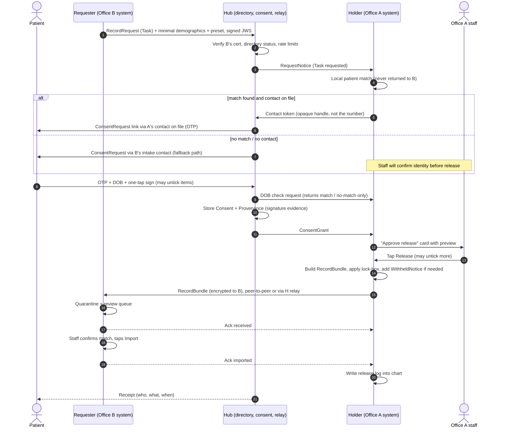
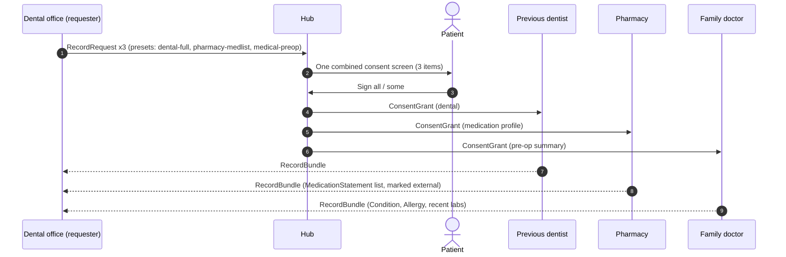
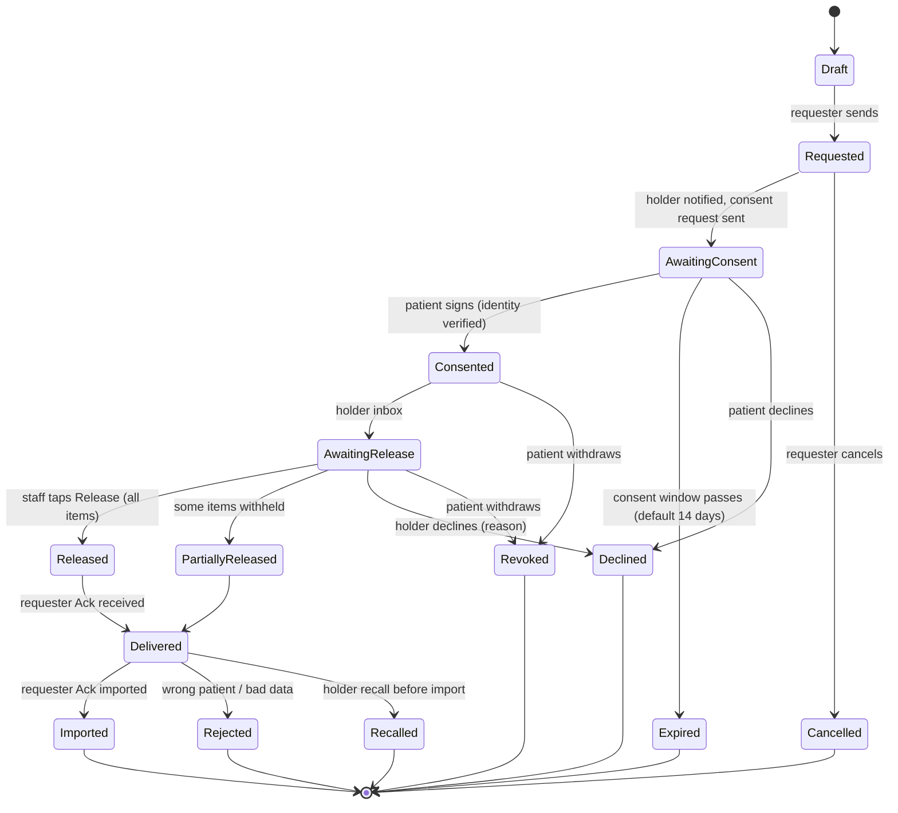

# PDRE protocol specification (draft 0.1)

**Patient-Directed Record Exchange (PDRE): the open protocol at the heart of OpenChart**

OpenChart is the open-source project; PDRE is its technical protocol. Products "implement PDRE". CareCircle Link is one hosted network built on OpenChart. See [NAMING.md](../NAMING.md).

Draft 0.1, 24 Nov 2026. Status: **design draft for discussion**. It is not ballot-ready and has not been implemented or tested. The key words MUST, SHOULD and MAY follow RFC 2119. All URLs under `example.org` are placeholders; no domain has been registered.

Design rule: **reuse existing standards wherever one exists.** PDRE defines a workflow, a consent and trust layer, and discipline presets on top of HL7 FHIR R4. It does not define a new clinical data format.

---

## 0. Built on FHIR

PDRE is a thin workflow, consent and trust layer on top of HL7® FHIR® R4 (4.0.1). It does not replace FHIR or invent a new clinical data format. What PDRE adds is what FHIR leaves open: a patient-signed consent step, a verified provider directory, a human release decision at the holding office, end-to-end encrypted delivery, and an audit trail every party can read.

| Layer | Standard used | Status in PDRE 0.1 |
|---|---|---|
| Data model | HL7 FHIR R4 (`Patient`, `Condition`, `AllergyIntolerance`, `MedicationRequest`/`MedicationStatement`, `Procedure`, `CarePlan`, `DocumentReference`, `ServiceRequest`, `Consent`, `Provenance`, `AuditEvent`, `Task`) | Core |
| Canadian profiles | CA Core+ (Canada Health Infoway) | Core, where profiles exist |
| Field-specific content | Published FHIR guides for a field where they exist (for example the HL7 Dental Data Exchange Implementation Guide for dental) | Optional content packs (for example `PDRE Dental-CA`); more fields to follow |
| Images | DICOM, referenced from `ImagingStudy` | Core |
| Vendor app authorisation | **SMART on FHIR**: SMART App Launch for user-facing apps and SMART Backend Services (client credentials with signed JWT) for system-to-system calls | Adopted as the standard authorisation model |
| Validation | FHIR validator against base R4, CA Core+ and PDRE profiles | **Required** in the conformance test suite |
| Reference server option | Medplum (open source, Apache-2.0, TypeScript) is a good candidate FHIR server for a reference hub. Its hosted cloud is US-based, so any deployment that handles real Canadian patient data should be self-hosted in Canada. | Suggested, not required |

Planned extensions (not part of 0.1):
- **Insurance eligibility:** `Coverage`, `CoverageEligibilityRequest` / `CoverageEligibilityResponse`, and later `Claim`.
- **Booking:** `Appointment`, `Slot` and `Schedule` for referral-to-appointment flows.
- **Legacy bridges:** HL7 v2 and CDA converters, only if hospital or lab connections need them.

Implementing FHIR alone does not give access to any vendor's system, and it does not by itself make anyone compliant with PHIPA, HIPAA or any other law. Systems still have to implement PDRE (or run the bridge), and every operator is responsible for its own legal and security obligations. See [DISCLAIMER.md](../DISCLAIMER.md).

---

## 1. Scope

In scope:
- Patient-consented transfer of records between two health organisations (custodians), for continuing care, moving, referral, second opinion, pre-procedure checks, or the patient's own copy.
- Any field of care: family practice, specialists, hospitals, pharmacy, dental, physiotherapy, chiropractic, optometry, mental health, labs and imaging, home and long-term care, allied health. The protocol is the same for all of them; only the content presets differ.
- Any system type: cloud, on-premise server, Windows desktop, or no system at all (the web app).

Out of scope for 0.x:
- Broadcast patient search or record-locator services.
- A central longitudinal record. PDRE moves copies; it does not store charts.
- Payer and research access.
- Real-time shared charts and e-prescribing (use existing provincial systems).

---

## 2. Actors

| Actor | Role | Typical system |
|---|---|---|
| **Patient** (or authorised substitute decision-maker or delegate) | Gives, scopes and withdraws consent; can request their own copy | Patient app, or a text/email link with no app |
| **Requesting provider** (Office B) | Asks for records | PMS/EMR with a PDRE client, or the OpenChart reference web app |
| **Holding provider** (Office A) | Custodian of the records; a person approves release | PMS/EMR with a PDRE server role, desktop bridge, or web app |
| **Pharmacy** | A holding provider for medication profiles | Pharmacy management system or web app |
| **Directory** | Verified list of organisations, practitioners, roles and endpoints | FHIR `Organization`, `Practitioner`, `PractitionerRole`, `HealthcareService`, `Endpoint` |
| **Consent service** | Sends consent requests, verifies patient identity, stores signed `Consent` and evidence | Part of a hub, or run by the holder |
| **Hub** | Routing, store-and-forward relay of encrypted payloads, audit, notifications. Several hubs can federate. | Any operator's hub, for example CareCircle Link (CareCircle's hosted network) or a self-hosted OpenChart hub |
| **Peer** | A provider system that exchanges directly with another peer, using the hub only for directory and consent | Large EMRs and health systems |
| **Bridge agent** | Small outbound-only service next to a desktop PMS that speaks PDRE on its behalf | Windows service |
| **Auditor** | The patient, custodian, regulator or privacy officer, reading audit records | Read-only APIs and exports |

---

## 3. Message types

Each message is a FHIR resource (or a Bundle of them), signed by the sender and carried over the transports in section 7.

| Message | Sent by → to | FHIR basis | Purpose |
|---|---|---|---|
| **RecordRequest** | Requester → holder (via hub) | `Task` (CA Core+ workflow pattern) with `Task.input` = preset and the item list, `Task.reasonCode` = purpose, and `Task.focus` → `ServiceRequest` for referrals | Asks for records. Carries only the minimum patient demographics needed for matching. |
| **RequestNotice** | Hub → holder | `Task` status `requested` | Tells the holder a request exists. The holder system matches locally and reveals nothing to the requester. |
| **ConsentRequest** | Consent service → patient | `Task` (owner = patient) plus a pre-filled `Consent` draft and a `QuestionnaireResponse` for fee and extra fields | Asks the patient to sign |
| **ConsentGrant** | Patient → consent service → holder and requester | `Consent` (status `active`) plus `Provenance` with signature and identity evidence | The patient's signed, scoped, time-limited authorisation |
| **ConsentRevoke** | Patient → consent service → all parties | `Consent` status `inactive`, with a new `Provenance` | Withdraws consent. It stops any pending release and does not reach back to data already delivered. |
| **ReleaseApproval** | Holder staff → holder system → hub | `Task` status `accepted` → `in-progress`, plus `Provenance` (agent = approving staff) | The human release decision, including any items unticked |
| **ReleaseDecline** | Holder → requester | `Task` status `rejected`, with `statusReason` | Decline with a reason: no match, consent invalid, restricted, or other |
| **RecordBundle** | Holder → requester | `Bundle` type `message` (`MessageHeader` first), wrapping a `Bundle` type `document` (`Composition` plus clinical resources) and `DocumentReference` / `ImagingStudy` / `Binary` | The records. Encrypted end-to-end to the requester. |
| **WithheldNotice** | Inside RecordBundle | `Composition.section` with code `withheld`, plus a bundle extension `pdre-withheld = true` | "Some information has been withheld at the patient's direction." It never says what. This is a PHIPA lock-box requirement. |
| **Ack** | Requester → holder (via hub) | `MessageHeader.response` (`ok`, `transient-error`, `fatal-error`), and `Task.businessStatus` = `received`, `imported`, `rejected-wrong-patient` | Delivery and import receipts |
| **Recall** | Holder → requester | `Task` status `cancelled` with `pdre-recall`, before import | Pulls back a bundle that was sent in error, before import |
| **AuditEvent** | Every actor → its own audit store, and the hub | `AuditEvent` | Every create, read, approve, send, receive, import, revoke and view |

---

## 4. End-to-end flows

### 4.1 Standard: new provider requests from previous provider



### 4.2 One signature, several holders (pre-surgery example)

The same pattern works in any field (a surgeon before an operation, a physio before rehab, a long-term care home on admission). Example: a dental office planning an implant asks the patient's previous dentist, pharmacy and family doctor at once. The patient signs **one** consent screen that lists three recipients and scopes. Under the hood these are three `Consent` resources, so each can be withdrawn separately. Each holder approves its own release.



### 4.3 Patient-initiated share (QR at the front desk)

The patient opens the app, taps **Share my records**, picks the previous provider(s) and scans the new office's QR code, or the office scans the patient's. That creates a RecordRequest that is **already consented**. The holder still approves the release.

### 4.4 Patient's own copy

The patient requests their record into the app. The holder approves under the right-of-access rules (PHIPA s. 52-54 timelines, fee estimate first). The bundle is encrypted to the patient's device key.

### 4.5 Referral and consult loop

Referral: a `ServiceRequest` plus the referral preset goes out. Consent may be implied in the circle of care where the law allows, but **PDRE 0.x always records express consent**; see [04-security-privacy](04-security-privacy.md). The consult note comes back as a new RecordBundle, linked through `Task.basedOn`.

---

## 5. Request state machine



Rules:
- **The requester never sees whether the holder matched the patient** until the patient has signed and the holder has acted. Before that, the requester only sees `AwaitingConsent` or `Expired`. This avoids revealing that someone is a patient somewhere. A lawyer must confirm this ordering ([04-security-privacy](04-security-privacy.md)).
- The default timers below are placeholders to tune in the pilot: consent window 14 days; holder action SLA as set by the office, with reminders at 2 and 5 business days, aligned to the RCDSO's 1 to 2 week guideline for dental; payload retention on the hub of 7 days after delivery, then crypto-shred.
- All transitions are idempotent (`Task.identifier` plus `If-Match` ETags) and produce an `AuditEvent`.

---

## 6. Data model

### 6.1 Base standards
- **HL7 FHIR R4 (4.0.1)** as the wire format. R4 is used because Canadian profiles and vendor support are on R4. An R5/R6 migration path is tracked in section 11.
- **CA Core+** (Infoway) for Canadian Patient, Practitioner, Organization, Condition, AllergyIntolerance, Medication*, Observation and Task/ServiceRequest workflow profiles ([CA Core+](https://simplifier.net/guide/CA-Core/Index/Technical-Context?version=current)). **PS-CA** is used for patient-summary shaped content.
- **HL7 Dental Data Exchange IG** for dental referral notes, consult notes, dental findings, odontogram and perio ([Dental Data Exchange IG](https://build.fhir.org/ig/HL7/dental-data-exchange/)), with a Canadian overlay: FDI/ISO 3950 tooth numbering, and CDA/USC&LS procedure codes subject to CDA licensing.
- **DICOM** for imaging (intraoral, pano, ceph, CBCT, optometry OCT, MSK imaging), referenced via `ImagingStudy`, with DICOMweb (STOW-RS/WADO-RS) where supported. Otherwise original full-resolution files go in `Binary` via `DocumentReference`. Screenshots are never used.
- **US realm:** US Core and the Dental Data Exchange IG as-is, CDT codes, the US national identifiers.
- Terminologies: SNOMED CT CA, LOINC, the Canadian Clinical Drug Data Set and DIN for medications, and ICD-10-CA where relevant. Each code system has its own licence, and implementers must hold their own licences.

### 6.2 Resource roles

| Need | FHIR resource(s) | Notes |
|---|---|---|
| Workflow | `Task`, `ServiceRequest` | One `Task` per holder per request |
| Consent | `Consent` | `scope` = patient-privacy; `provision.actor` = recipient org; `provision.class`/`code` = preset items; `provision.period` = validity; `purpose` = TREAT / PATRQT / COC |
| Signature and identity evidence | `Provenance` (`signature`, `entity`), plus PDRE extensions `pdre-identity-evidence` (OTP channel, DOB match result, method, timestamp, device hash) | Signature is a JWS over the canonical Consent |
| Envelope | `Bundle` type `message` + `MessageHeader` | `MessageHeader.focus` → document bundle |
| Clinical document | `Bundle` type `document` + `Composition` | Sections per discipline preset; human-readable `text` always present |
| Files and imaging | `DocumentReference`, `Binary`, `ImagingStudy` / DICOM | Large files go to chunked upload, referenced by URL with a hash |
| Medications | `MedicationStatement`, `MedicationRequest` (from pharmacy), `Medication` | Always tagged `pdre-external-unverified` on receipt |
| Allergies, problems | `AllergyIntolerance`, `Condition` | Same tagging |
| Plans | `CarePlan`, `ServiceRequest` (planned treatment), `Procedure` (history) | Dental treatment plan = `CarePlan` with `activity` → `ServiceRequest` per tooth/procedure |
| Observations | `Observation` (perio, vitals, ROM, visual acuity, labs), `DiagnosticReport` | |
| Encounters | `Encounter` (summary level) | |
| Audit | `AuditEvent` | |
| Directory | `Organization`, `Practitioner`, `PractitionerRole`, `HealthcareService`, `Location`, `Endpoint`, `VerificationResult` | `VerificationResult` records college register checks |

### 6.3 Data quality rules
- Every bundle MUST include a human-readable summary (PDF via `DocumentReference`, plus `Composition.text`), so the receiver can use it even if structured import fails.
- Structured clinical data that changes care (allergies, medications, conditions) MUST be imported as **external, needs clinician verification**. It is never silently merged into the active list.
- Source originals are never altered or deleted. The holder keeps its record under its retention rules.

---

## 7. Discipline bundle presets

Presets are named, versioned sets of items. They let nobody pick 15 checkboxes by hand. Each preset maps to `Consent.provision` codes so the consent and the release always match.

| Preset code | Discipline | Includes (default) | Optional |
|---|---|---|---|
| `dental-full` | Dental, patient moving | Demographics, medical history and alerts, allergies, medications, odontogram/charting, perio charts, treatment history (`Procedure`), active treatment plans (`CarePlan`), radiographs and photos (DICOM/originals), clinical notes for the last N years (office sets N) | Ledger summary (only if the patient asks), ortho records, models/scans (STL) |
| `dental-referral` | Dental to specialist | Reason (`ServiceRequest`), relevant radiographs, medical alerts, relevant chart and perio, referral letter (Dental Data Exchange Referral Note) | CBCT |
| `dental-consult-return` | Specialist to GP | Consult note, findings, plan, images | |
| `dental-txplan` | Second opinion | Treatment plan + supporting images | |
| `medical-summary` | Medical | PS-CA-shaped summary: problems, allergies, medications, immunizations, recent results, encounters summary | Full notes for a date range |
| `medical-preop` | Medical to dental or surgical | Problems relevant to surgery or sedation, allergies, current medications, anticoagulation status, recent INR/CBC and other relevant labs, cardiac or bisphosphonate history | Specialist letters |
| `pharmacy-medlist` | Pharmacy | Dispensing history for N months (`MedicationDispense` → summarised to `MedicationStatement`), allergies on file | Prescriber list |
| `physio-full` | Physiotherapy | Assessment, diagnosis, plan of care, outcome measures (`Observation`), progress and discharge notes, imaging reports | Exercise program |
| `chiro-full` | Chiropractic | Assessment, diagnosis, treatment plan, X-ray images and reports, progress notes | |
| `optometry-full` | Optometry | Exam findings, refraction and Rx, IOP, imaging (OCT, fundus) | Contact-lens specs |
| `imaging-only` | Any | Images + reports in the date range | |
| `custom` | Any | Item-by-item selection | |

New presets are added through governance ([06-governance-and-licensing](06-governance-and-licensing.md)). Vendors MUST support the presets for their discipline at their conformance level.

---

## 8. Transport

### 8.1 Patterns
1. **Hub-relayed (default).** Requester and holder both talk to a hub over HTTPS. The hub relays **end-to-end encrypted** payloads and cannot read clinical content. This is best for small offices, desktop systems and NAT-bound networks.
2. **Peer-to-peer.** Large systems publish an `Endpoint` in the directory. The requester sends the `Task` to the holder's FHIR server directly, and the payload goes direct. The hub provides directory, consent and audit copies of metadata only.
3. **Federated hubs.** Hubs from different operators exchange `Task` and relay payloads using the same API, with mutual trust via the trust framework (section 9). **A conformant hub MUST federate with other certified hubs**, so the network never splits.

### 8.2 APIs
- **FHIR REST** for `Task`, `Consent`, `Provenance`, directory reads and `AuditEvent` export. `Subscription` (R4 backport topic-based subscriptions) or webhooks notify of state changes.
- **Async messaging** with FHIR messaging (`$process-message`) over HTTPS for the RecordBundle and Acks, and at-least-once delivery with idempotency keys (`MessageHeader.id`).
- **Large payloads:** resumable chunked upload (tus-style or S3-compatible multipart through the hub), each chunk encrypted. Manifests carry SHA-256 hashes. DICOMweb STOW-RS is used for peer-to-peer imaging.
- **Bridge agent:** opens an **outbound-only** mutually authenticated WebSocket or long-poll to the hub, so the office needs no open inbound ports.

### 8.3 Example endpoints (hub)

```
POST   /fhir/Task                        RecordRequest
GET    /fhir/Task?owner=Organization/123&status=requested   holder inbox
POST   /fhir/Task/{id}/$approve-release  ReleaseApproval (holder)
POST   /fhir/Task/{id}/$decline          ReleaseDecline
POST   /fhir/$process-message            RecordBundle / Ack (encrypted payload in Binary)
POST   /fhir/Consent                     ConsentGrant (consent service only)
POST   /fhir/Consent/{id}/$revoke        ConsentRevoke
GET    /fhir/Organization?name=&address-city=&discipline=   directory search
GET    /fhir/AuditEvent?entity=Task/{id} audit trail
GET    /.well-known/udap                 trust metadata
GET    /.well-known/smart-configuration  OAuth metadata
```

---

## 9. Identity and trust (organisations and systems)

### 9.1 Directory and verification
- Every organisation is verified **before** it can send or receive. Checks: (1) practitioner(s) against the **public register of the relevant college** (for example RCDSO, CPSO, Ontario College of Pharmacists, College of Physiotherapists of Ontario, College of Chiropractors of Ontario, College of Optometrists of Ontario); (2) the business and address; (3) a named privacy contact; (4) a signed participation agreement. Each check is recorded as a `VerificationResult`, re-checked on a schedule (placeholder: every 90 days) and on any register change.
- Directory entries hold no patient data.

### 9.2 System authentication
- **Trust framework with X.509.** The network operates a certificate authority, or uses a recognised trust anchor, that issues certificates to verified organisations and certified software. This is modelled on the HL7 FAST / UDAP Security IG trust-community approach ([UDAP Security IG STU2](https://hl7.org/fhir/us/udap-security/STU2/)).
- **UDAP dynamic client registration** with signed software statements, so certified software registers itself with any hub without manual key exchange.
- **OAuth 2.0 client credentials with `private_key_jwt`**, per **SMART Backend Services**, for system-to-system calls. Access tokens are short-lived (≤ 5 minutes) and scoped (for example `system/Task.cruds?owner=Organization/123`).
- **mTLS** on all hub and peer connections.
- **Signed messages:** every `Task`, `Consent` and `MessageHeader` carries a detached **JWS** (ES256) by the sending organisation's key, so the receiver can prove origin even after relay.
- **End-to-end encryption:** RecordBundle payloads are **JWE**-encrypted (ECDH-ES + A256GCM) to the recipient organisation's current public key from the directory. Hubs hold ciphertext only.
- **Per-release capability token:** an approved release mints a **single-use, short-lived token** bound to that Task, that recipient and that payload hash.

### 9.3 Staff (user) authentication
- In integrated systems, the PMS/EMR's own login with MFA. The vendor attests the user and role in the `Provenance.agent`.
- In the web app: OIDC SSO (Microsoft, Google) or passkeys, MFA required, and role-based (who may request, who may approve release).

---

## 10. Patient identity verification

Before a signature counts, the consent service MUST verify the signer using one of these assurance paths and record it in `pdre-identity-evidence`:

| Path | Steps | Assurance |
|---|---|---|
| **A. Holder-contact OTP + DOB (preferred)** | OTP to the phone or email **the holder already has on file**, sent by the hub with an opaque contact token so the requester never sees it; the patient types DOB; the holder system compares locally and returns match/no-match only | High |
| **B. Requester-contact OTP + DOB + holder staff check** | OTP to the contact the requester collected; DOB checked at the holder; holder staff confirm identity (for example by phone) before release | Medium, so a human check is required |
| **C. In-person** | The patient signs on a tablet at the requesting office after photo ID is checked; staff attest in `Provenance` | Medium-high |
| **D. Patient app account** | A passkey-secured app account previously bound to the holder via path A | High, and enables one-tap repeat consents |
| **E. Provincial or federal digital ID** | Only if one is available and approved for health use. **Not assumed.** | High |

Substitute decision-makers and delegates (parents of minors, POA for personal care, caregivers) are recorded as `Consent.performer` with the relationship and evidence. Delegation rules need legal review per province ([02-patient-app](02-patient-app.md)).

---

## 11. Consent model

- **Express, recorded consent for every transfer in 0.x**, even where implied consent might be lawful. This keeps one simple product and matches College preferences for written direction.
- **Granular:** per recipient, per preset, item-level unticks.
- **Time-limited:** `provision.period` (default 30 days for one-off transfers; an ongoing referral relationship may be longer, set by the patient).
- **Purpose-bound:** `purpose` codes (`TREAT`, `COC`, `PATRQT`).
- **Revocable:** `$revoke` at any time. Revocation stops pending releases and future sharing, and is not retroactive for delivered data. Receivers are notified.
- **Lock-box:** holders flag restricted items. Restricted items are never in a default bundle. Releasing them needs the patient's fresh express consent for that item. When anything reasonably necessary is held back, the bundle MUST carry a **WithheldNotice** without content details.
- **Fee transparency:** if the holder charges a fee, the estimate is shown before signing (`QuestionnaireResponse`). The fee must be lawful reasonable cost recovery. Holders may waive it.
- **Plain-language consent text** at a target reading level, in the patient's language, with the legal text available.

---

## 12. Audit

- Every actor writes `AuditEvent` for: request created, notice received, consent sent, OTP verified or failed, consent signed or revoked, release approved or declined, payload sent, received, imported or rejected, recall, record viewed, export.
- Hub audit is **append-only and tamper-evident**: hash-chained entries, with periodic anchoring of the chain head to write-once storage (WORM / object lock).
- Each custodian can export its own audit. The patient can see every event about them in the app.
- Audit entries hold **identifiers and metadata, not clinical content**.
- The hub audit doubles as the electronic record a health information network provider must keep and provide under Ontario's O. Reg. 329/04 s. 6 (to be confirmed by counsel; see [04-security-privacy](04-security-privacy.md)).

---

## 13. Versioning and extensibility

- **Semantic versioning** for the spec (`MAJOR.MINOR.PATCH`). Every message carries `MessageHeader.meta.profile` and a `pdre-version` extension. Systems publish a `CapabilityStatement` with supported PDRE version, presets and conformance level.
- Minor versions are backward compatible. A hub MUST accept the current and previous minor versions. Major versions get **at least 12 months' overlap** and a published migration guide.
- Extensions live under one canonical base (`https://example.org/pdre/StructureDefinition/...`, placeholder). Vendor extensions are allowed if they are namespaced and ignorable.
- R5/R6 path: track FHIR R5 `Permission` and R6 when Canadian profiles move, with a dual-publish period.

---

## 14. Conformance levels

| Level | Name | Must do | Typical adopter |
|---|---|---|---|
| **L0** | Web participant | Use the hosted web app to request, approve, send (upload) and receive (download into PMS) | Office whose PMS hasn't integrated |
| **L1** | Receiver | Receive RecordBundles into the system's document centre (PDF + images) and send Acks | Any PMS, first integration |
| **L2** | Requester + Sender (documents) | Embed "Request records"; receive the release inbox; export documents + images automatically | Most PMS vendors at launch |
| **L3** | Structured exchange | Export and import the discipline's structured resources (allergies, meds, conditions, charting, plans), with external-unverified tagging | Mature integrations |
| **L4** | Peer node | Run its own PDRE FHIR endpoint, peer-to-peer transport, its own audit | Large EMRs, health systems |
| **H** | Hub operator | Directory, consent service, relay, audit, federation, SLAs, security programme | CareCircle Link, other operators |

Each level has a test plan in the conformance suite ([03-provider-app-and-sdk](03-provider-app-and-sdk.md)). The "OpenChart Certified" mark is granted per level and per discipline.

---

## 15. Example messages

These are illustrative and not validated against final profiles. IDs and URLs are fake.

### 15.1 RecordRequest (`Task`)

```json
{
  "resourceType": "Task",
  "id": "req-7f3a",
  "meta": { "profile": ["https://example.org/pdre/StructureDefinition/pdre-record-request"] },
  "identifier": [{ "system": "https://example.org/pdre/request-id", "value": "7f3a2c1e-9b0d-4e55-8a71-2f4c0d9e1b6a" }],
  "status": "requested",
  "intent": "order",
  "code": { "coding": [{ "system": "https://example.org/pdre/CodeSystem/task-type", "code": "record-request" }] },
  "reasonCode": { "coding": [{ "system": "http://terminology.hl7.org/CodeSystem/v3-ActReason", "code": "TREAT" }], "text": "Patient moved; continuing dental care" },
  "requester": { "reference": "Organization/office-b-london", "display": "Example Dental, London ON" },
  "owner": { "reference": "Organization/office-a-ajax", "display": "Sample Family Dentistry, Ajax ON" },
  "authoredOn": "2026-11-24T10:15:00-05:00",
  "restriction": { "period": { "end": "2026-12-08T23:59:59-05:00" } },
  "input": [
    { "type": { "text": "preset" }, "valueCode": "dental-full" },
    { "type": { "text": "notes-years" }, "valueInteger": 5 },
    { "type": { "text": "match-demographics" },
      "valueReference": { "reference": "#pt" } }
  ],
  "contained": [{
    "resourceType": "Patient", "id": "pt",
    "name": [{ "family": "Doe", "given": ["Jane"] }],
    "birthDate": "1988-04-12",
    "telecom": [{ "system": "phone", "value": "+1-555-0100", "use": "mobile" }]
  }]
}
```

### 15.2 ConsentGrant (`Consent`)

```json
{
  "resourceType": "Consent",
  "id": "cns-91b2",
  "status": "active",
  "scope": { "coding": [{ "system": "http://terminology.hl7.org/CodeSystem/consentscope", "code": "patient-privacy" }] },
  "category": [{ "coding": [{ "system": "http://loinc.org", "code": "59284-0" }] }],
  "patient": { "display": "Jane Doe (identity verified, path A)" },
  "dateTime": "2026-11-24T10:22:41-05:00",
  "performer": [{ "display": "Jane Doe (self)" }],
  "organization": [{ "reference": "Organization/office-a-ajax" }],
  "sourceReference": { "reference": "QuestionnaireResponse/cns-91b2-form" },
  "policy": [{ "uri": "https://example.org/pdre/policy/ca-on-express-consent-v1" }],
  "provision": {
    "type": "permit",
    "period": { "start": "2026-11-24", "end": "2026-12-24" },
    "actor": [{
      "role": { "coding": [{ "system": "http://terminology.hl7.org/CodeSystem/v3-ParticipationType", "code": "IRCP" }] },
      "reference": { "reference": "Organization/office-b-london" }
    }],
    "purpose": [{ "system": "http://terminology.hl7.org/CodeSystem/v3-ActReason", "code": "TREAT" }],
    "code": [{ "coding": [{ "system": "https://example.org/pdre/CodeSystem/preset", "code": "dental-full" }] }],
    "provision": [{
      "type": "deny",
      "code": [{ "coding": [{ "system": "https://example.org/pdre/CodeSystem/item", "code": "ledger-summary" }] }]
    }]
  }
}
```

The matching `Provenance` (not shown) carries `target` = this Consent, a `signature` (JWS over the canonical JSON), and the `pdre-identity-evidence` extension: `{ "path": "A", "otpChannel": "sms-holder-contact", "otpVerifiedAt": "...", "dobMatch": true, "deviceHash": "..." }`.

### 15.3 RecordBundle envelope (decrypted view)

```json
{
  "resourceType": "Bundle",
  "type": "message",
  "id": "msg-55c0",
  "timestamp": "2026-11-24T14:03:10-05:00",
  "entry": [
    { "resource": {
        "resourceType": "MessageHeader",
        "id": "mh-55c0",
        "eventCoding": { "system": "https://example.org/pdre/CodeSystem/event", "code": "record-bundle" },
        "source": { "endpoint": "https://hub.example.org/org/office-a-ajax" },
        "destination": [{ "endpoint": "https://hub.example.org/org/office-b-london" }],
        "focus": [{ "reference": "Bundle/doc-55c0" }],
        "extension": [
          { "url": "https://example.org/pdre/StructureDefinition/pdre-task", "valueReference": { "reference": "Task/req-7f3a" } },
          { "url": "https://example.org/pdre/StructureDefinition/pdre-consent", "valueReference": { "reference": "Consent/cns-91b2" } },
          { "url": "https://example.org/pdre/StructureDefinition/pdre-withheld", "valueBoolean": true }
        ]
    }},
    { "resource": {
        "resourceType": "Bundle", "id": "doc-55c0", "type": "document",
        "entry": [
          { "resource": { "resourceType": "Composition", "status": "final",
              "type": { "text": "PDRE dental-full transfer" }, "title": "Records transfer: Jane Doe",
              "date": "2026-11-24", "author": [{ "reference": "Organization/office-a-ajax" }],
              "section": [
                { "title": "Allergies", "entry": [{ "reference": "AllergyIntolerance/al1" }] },
                { "title": "Medications", "entry": [{ "reference": "MedicationStatement/ms1" }] },
                { "title": "Treatment plan", "entry": [{ "reference": "CarePlan/cp1" }] },
                { "title": "Radiographs", "entry": [{ "reference": "ImagingStudy/is1" }] },
                { "title": "Information withheld",
                  "code": { "coding": [{ "system": "https://example.org/pdre/CodeSystem/section", "code": "withheld" }] },
                  "text": { "status": "generated", "div": "<div xmlns=\"http://www.w3.org/1999/xhtml\">Some information has been withheld at the patient's direction.</div>" } }
              ] } }
        ]
    }}
  ]
}
```

### 15.4 Ack

```json
{
  "resourceType": "MessageHeader",
  "eventCoding": { "system": "https://example.org/pdre/CodeSystem/event", "code": "ack" },
  "source": { "endpoint": "https://hub.example.org/org/office-b-london" },
  "response": { "identifier": "mh-55c0", "code": "ok" },
  "extension": [{ "url": "https://example.org/pdre/StructureDefinition/pdre-business-status", "valueCode": "imported" }]
}
```

---

## 16. Open questions for the spec work group
1. Whether the holder's local match step before consent is acceptable under PHIPA, or must strictly follow consent (needs legal input).
2. Which FHIR consent pattern best maps to Canadian provinces, and alignment with CA Core+ privacy and consent modules when Infoway publishes them.
3. CDA code-set licensing for redistributing dental procedure codes in examples and test data.
4. Whether to adopt SMART Health Links for patient-carried shares (section 4.3) in addition to network Tasks ([SMART Health Links](https://build.fhir.org/ig/HL7/smart-health-cards-and-links/links-specification.html)).
5. A certificate authority choice: run our own, or use an existing healthcare trust anchor.
