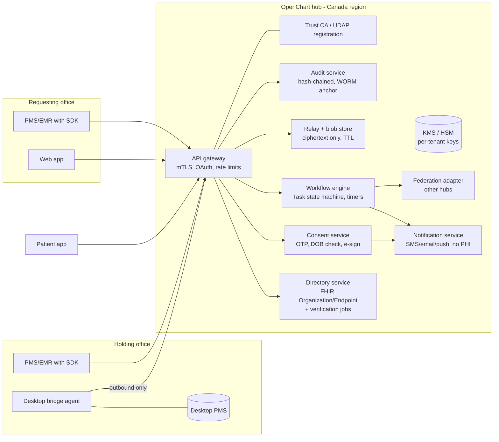

# Reference architecture

Draft 24 Nov 2026. This is a recommended design for the open-source OpenChart reference hub, which any operator (including CareCircle Link) can run. Nothing is built or deployed, and the cloud choices below are recommendations, not commitments.

---

## 1. Components

| Component | Responsibility | Holds PHI? |
|---|---|---|
| API gateway | mTLS termination, token validation, tenant routing, rate limits, WAF | No (pass-through) |
| Directory service | Organisations, practitioners, roles, endpoints, public keys; college register verification jobs | No |
| Consent service | Sends consent requests, OTP, DOB check via the holder, signature capture, `Consent` + `Provenance` storage | **Minimal**: name, DOB check result, contact token. No clinical data. |
| Workflow engine | `Task` lifecycle, timers, reminders, retries, idempotency | Metadata only |
| Relay and blob store | Store-and-forward of **encrypted** bundles; chunked upload; TTL and crypto-shred | Ciphertext only |
| Audit service | Append-only hash-chained `AuditEvent`, anchored to WORM storage; exports | Identifiers and metadata |
| Notification service | SMS, email, push; templates contain no clinical detail | Contact details |
| Trust CA / registration | Issues certificates to verified orgs and certified software; UDAP DCR | No |
| Federation adapter | Exchanges Tasks and relays with other certified hubs | Ciphertext + metadata |
| Admin console | Office onboarding, verification queue, support (with no PHI access by default; break-glass logged) | No |
| Patient app back end | Patient accounts, delegation, activity feed (from audit), own-copy delivery (encrypted to device) | Minimal |

---

## 2. Hosting options

| Option | Who runs it | Use case |
|---|---|---|
| **CareCircle Link (Canada)** | CareCircle Connect Inc. | Default for Canadian offices and vendors. Primary and DR both in Canadian regions. |
| **Self-hosted hub** | A health system, a DSO, a province, or another operator | Same open code; must pass hub-operator (H) conformance and federate |
| **Peer node** | A large EMR or health system | Its own FHIR endpoint; uses a hub for directory and consent only |
| **On-prem bridge** | Each desktop office | Outbound-only agent |
| **US stack (later)** | CareCircle (separate entity or region) | Separate US-region deployment, BAAs, no data mixing with Canada |

Cloud candidates with Canadian regions: AWS (Canada Central, Calgary), Microsoft Azure (Canada Central, Canada East), Google Cloud (Montréal, Toronto). Choose one primary and pick based on BAA/PHIPA agreement terms, KMS/HSM options and cost. Each operator makes that decision for itself. **Do not** use edge or serverless platforms whose PHI-processing locations can't be pinned to Canada for any PHI path.

---

## 3. Recommended tech stack (reference implementation)

| Layer | Recommendation | Why |
|---|---|---|
| Language (services) | **TypeScript (Node.js LTS)** for workflow, consent, gateway glue; **Java (HAPI FHIR)** for the FHIR server/validation | TypeScript matches the SDK and the CareCircle team; HAPI FHIR is mature, open source (Apache-2.0) and widely used |
| FHIR store | HAPI FHIR JPA server on Postgres for directory, `Task`, `Consent`, `Provenance`, `AuditEvent` metadata | Standards-complete, with profile validation built in |
| Database | **PostgreSQL** with row-level security per tenant | Tenant isolation |
| Durable workflows | Temporal (self-hosted) or an equivalent durable-execution engine | Timers, retries, survives restarts |
| Messaging | Managed queue (SQS/Service Bus/PubSub) or NATS JetStream | At-least-once with idempotency |
| Blob store | S3-compatible object storage with **object lock** (audit anchor) and lifecycle TTL (payloads) | Ciphertext + WORM |
| Keys | Cloud KMS + HSM-backed keys, per-tenant data keys (envelope encryption) | Crypto-shred on delete |
| Identity (staff, web app) | OIDC (Microsoft, Google) + passkeys, MFA enforced | |
| Patient app | React Native (iOS/Android) + PWA | One codebase; secure enclave access |
| Desktop bridge | .NET 8+ Windows service | Fits Windows PMS environment |
| Observability | OpenTelemetry traces/metrics/logs with **PHI scrubbing at source**; per-tenant cost tracking | Engineering standard |
| IaC | Terraform/OpenTofu; policy-as-code (OPA) | Repeatable, reviewable |
| CI/CD | Signed builds, SBOM, dependency scanning, conformance suite in CI | Supply-chain safety |

---

## 4. Scaling

- **Stateless services** behind the gateway scale horizontally. The workflow engine scales by task queue.
- **Payload size**: structured bundles are small (KB to low MB). Imaging dominates (CBCT can be large), so chunked resumable upload goes direct to object storage via pre-signed URLs, and the hub never buffers whole files in memory.
- **Peer-to-peer for large systems** keeps heavy traffic off the hub.
- **Directory reads** are cached with short TTLs and signed directory snapshots for offline bridge validation.
- **Multi-region**: active primary in one Canadian region, warm DR in a second. Recovery objectives to be set (placeholders: RPO ≤ 15 min, RTO ≤ 4 h).
- **Federation** spreads load across operators as the network grows.
- **Cost controls**: per-tenant metering (requests, bytes relayed, SMS), budgets and alerts. SMS is likely the largest variable cost, so prefer push or email where the patient agrees.

---

## 5. Operations runbooks (to write in full before pilot)

| Runbook | Trigger | Key steps |
|---|---|---|
| **Failed delivery** | Ack not received within SLA | Auto-retry with backoff → alert both offices → check bridge health → resend from holder (new token) → close or escalate |
| **Wrong-patient release** | Receiver rejects as wrong patient, or holder detects error | Freeze Task → recall if not imported → receiver deletes copy and attests → audit review → notify affected patient(s) and custodians → assess IPC notification with counsel → root cause → fix |
| **Suspected breach / key compromise** | Alert, report or anomaly | Contain (revoke certs/tokens, rotate keys) → preserve evidence → assess scope from audit → notify custodians (HINP duty) → custodians notify patients/IPC as required → post-incident review |
| **Bridge offline** | Missed heartbeats | Notify office → queue requests → guided restart → fallback to web app upload |
| **Directory verification failure** | College register shows a change (for example a suspension) | Suspend sending/receiving for that org → notify → human review → restore or offboard |
| **Consent revoked mid-flight** | ConsentRevoke received | Cancel pending release → purge relay copy → notify receiver → audit |
| **Abuse / fishing pattern** | Unusual request volume or decline ratio | Rate-limit → review → suspend if needed |
| **Data subject request** | Patient asks for their audit, or deletion of their app account | Export or delete per policy; explain what custodians must keep |
| **Spec version rollout** | New minor/major | Staged rollout, dual-version acceptance, vendor comms, deprecation timers |
| **DR failover** | Region outage | Fail over to second Canadian region → verify integrity of audit chain → communicate status |

Operational roles: on-call engineer, privacy officer, security lead, vendor support. Status page, and incident communications templates reviewed by counsel.
